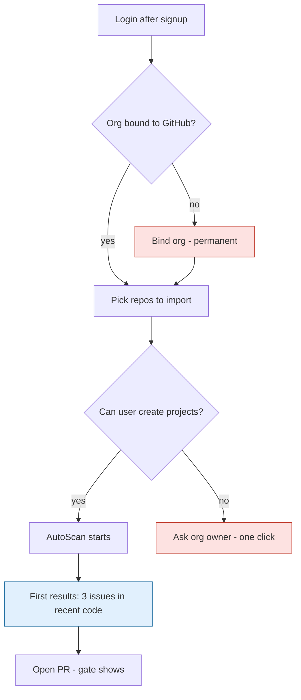
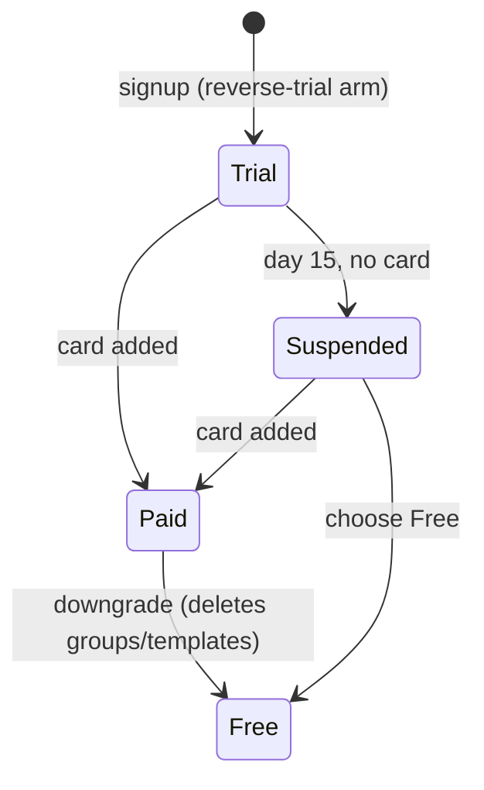
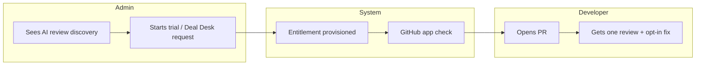

# Flow playbook: walking, stress-testing and sketching SonarQube flows

**As of:** 2026-10-29. This file is about *how* to think through a flow. For the product facts it depends on, see `product.md`; for evidence about users, see `users-and-findings.md`.

## Contents
1. The persona card (fill it in before walking anything)
2. The step-by-step walk protocol
3. The forgotten-persona pass
4. The permission and state check
5. Edge and failure states that SonarQube flows usually forget
6. Session formats (diverge, walk, compare, pre-mortem, spec review)
7. Mermaid templates
8. Handing off to UX

---

## 1. The persona card

A flow can't be judged without knowing exactly who is on the screen. "The user" is not a persona. Fill these in, and make an explicit assumption wherever you don't know:

| Field | Example |
|---|---|
| Role | Engineering manager, 12-person team, also GitHub org admin |
| Product and plan state | SQC, reverse-trial arm, day 9 of 14, no card |
| Platform | GitHub Cloud, 40 repos, 6 actively used |
| Permissions | SQC org owner; GitHub org owner, so they can install the app on all repos |
| Analysis method | AutoScan on 3 repos, no CI |
| What they just did | Got an email: "5 days left in your trial" |
| What they want right now (job) | Decide whether it's worth paying before the team gets used to it |
| What they fear | Surprise charges; the team seeing noisy PR comments and blaming them |
| What's open in the other tab | GitHub Copilot code review settings, comparing |
| Stakes | Small budget, but they look bad if they champion a tool the team ignores |

Personas the team uses (details in `users-and-findings.md` §2):
- **Weekend Explorer**: individual developer, no mandate; one sitting to succeed.
- **Stalled Rollout champion**: enterprise, 6–18 months after purchase; developers ignore the tool.
- **Shelfware / compliance champion**: needs audit evidence; outnumbered.
- **Core first person** for self-serve: high motivation and able to finish setup (GitHub org admin, EM).
- **Creator / Contributor / Viewer** roles within a team.
- **Enterprise roles**: lead admin, identity owner (often not the Sonar admin), DevOps integrator, license recipient (not necessarily the implementer), development teams that must start scans.
- **Coming next**: corporate self-serve Team at a business email; existing sales-led admins discovering Gitar; developers verifying AI-generated code.

## 2. The step-by-step walk protocol

Walk the flow one screen or moment at a time. For each step write a compact block:

```
Step N — [screen / moment]
Sees:    what's on screen (and what's NOT there that they'd expect)
Thinks:  the question in their head, in their words
Feels:   confident / unsure / anxious / bored / delighted (and why)
Can do:  given their role, plan and permissions, what actions actually work
Breaks:  what goes wrong here (permissions, platform, state, errors, copy)
Leaves?: likelihood they drop off here, and where they go instead
```

Rules:
- **Use their words in "Thinks".** Write "Wait, will this charge my card?", not "user evaluates pricing".
- **Check every "Can do" against `product.md`.** This is where invented flows die. If you're not sure the action is allowed, say "(check: can a member with Browse only do X?)".
- **Mark the leverage step** (Doshi LNO), the one step that decides success. It usually involves seeing their own code scanned, a first finding they care about, or a teammate getting value.
- **Mark the peak and the end** (peak-end rule). How do they feel at the best moment, and how do they feel when they leave?
- **Time and effort.** Note how long each step takes in real life: CI setup is hours to days; AutoScan is minutes.
- **Prefer short walks.** Six to ten steps is usually right. If there are more, the flow is probably too long, and that is itself a finding.

## 3. The forgotten-persona pass

After walking the main persona, re-walk the flow quickly (only the steps that change) for at least one of these. Pick the ones most likely to break this specific flow:

| Forgotten persona | Why flows fail them |
|---|---|
| Non-admin org **member** | Can't create projects, change gates, install apps or see billing; hits a dead end with no way to ask the admin |
| **Second user** joining an existing org | Lands without context; the flow assumes they set things up |
| **Azure DevOps / GitLab / Bitbucket** user | AutoScan, import, member sync and the AI products are GitHub-first; Bitbucket has no AutoScan |
| **SQS admin** | Self-managed; different release cadence (LTA), licensing, no Cloud billing, often air-gapped or slow to upgrade |
| **Trial-ended / suspended** org | Reverse-trial day 15 = suspension; what do they see, what still works, what do teammates see? |
| **Monthly vs annual** customer | Annual Team / Enterprise are sales-led; self-serve upgrade paths don't apply |
| **LOC-capped** org | The analysis is refused when over the limit; what do the developer and the PR author see? |
| **Free-plan** user | Main branch only, no permission editing, 5 members, 50k private LOC |
| **Enterprise with SSO/SCIM** | Users provisioned by IdP; invite flows and self-join behave differently |
| **The developer who didn't ask for this** | Mandated user; sees Sonar as a velocity tax; first impression is a red gate |
| **Agent / MCP user** | Meets Sonar inside Cursor or Claude Code, never sees the web UI |

## 4. The permission and state check

Before calling a flow done, answer these. Facts are in `product.md` §11–§16.

1. **Who can trigger each action?** Org owner / Administer org; Create projects; Execute analysis; project Administer; Browse. Cloud and Server differ.
2. **What does someone without permission see?** A hidden button, a disabled button with an explanation, or "ask your admin" with a one-click request? Hidden buttons create confusion; disabled buttons with a reason and a route are better.
3. **Which permission template applies to projects created in this flow?** Templates apply once, at creation. Does the flow create projects that the right people can see?
4. **DevOps binding:** is the org bound? Binding is permanent and unlocks import, AutoScan, PR decoration and member sync. On GitHub, is the repo in the SonarQube Cloud app's access list?
5. **Plan state:** Free / Team / Enterprise / trial (which arm, which day) / suspended / over LOC.
6. **Identity:** GitHub login vs email vs SSO; is member sync on?
7. **Cloud enterprise vs organization:** does the action live at the enterprise level (LOC pool, SSO) or the org level?
8. **Reversibility:** can it be undone? Downgrading to Free deletes custom groups, templates and org tokens. Binding can't be changed.

## 5. Edge and failure states SonarQube flows usually forget

- First analysis **fails** (build error, wrong scanner, missing token, CI misconfigured), and the user has no logs on AutoScan.
- First analysis **succeeds with 0 issues**: is that a success moment or "is it even working?"
- First analysis returns **hundreds of issues** (the anti-aha). What's the one next step?
- Repo **not accessible** to the GitHub app, or only some repos selected at install time.
- **AutoScan and CI both running**: the build breaks.
- **Monorepo** (AutoScan doesn't support it).
- **Coverage missing** (AutoScan has none), so the quality gate on coverage fails or reads as "no data".
- **Email bounce / no work email**: the trial-end and nurture emails never arrive.
- **Card declined at first charge**: 47% of native suspensions fail at first charge.
- **User backs out of onboarding**: the subscription gets cancelled (94 early cancellations observed).
- **Two people set up at once** in the same company and create duplicate orgs.
- **Org admin leaves the company**: who owns billing and permissions now?
- **Mobile or narrow screen**, for emails and PR comments read on phones.
- **Copy implying something is included or automatic** when it isn't.

## 6. Session formats

Pick one per session based on the mode the user is in (see SKILL.md).

**Diverge (idea generation)**
1. Restate the problem as: [person] trying to [job] at [moment], blocked by [obstacle].
2. Generate 5–8 options across very different levers: remove a step, change the default, change the framing (Sutherland), change the loop (Verna), change who does it (admin vs developer vs agent), change the timing, change the price or packaging, or do nothing and measure.
3. Mark one as bold. Cluster the rest. Recommend 2–3 to explore.

**Walk (flow review)**
Persona card, then the step-by-step walk, then the forgotten-persona pass, then the permission and state check, then "where it breaks", then a diagram.

**Compare (converge)**
A table of options against 4–5 criteria that matter for *this* decision (usually: impact on the leverage step, who it fails, effort, reversibility, measurability). Make the call, and say what evidence would flip it.

**Pre-mortem**
"It's 15 Dec and this failed. Why?" List the causes, classify each as a tiger, paper tiger or elephant, then give mitigations for tigers and a way to surface each elephant.

**Spec / mock review (before UX)**
Check it for: the problem is clear, the persona is specific, the permission states are covered, every platform is addressed or explicitly excluded, failure states are present, copy is honest, measurement and a kill rule exist, and the open questions are listed.

## 7. Mermaid templates

Keep labels short. Put permission and state branches in diamonds. Mark drop-off risks with a `:::risk` class and the leverage step with `:::lever`.

**Basic flow with permission branch**


**State machine (trials, plans)**


**Swimlanes (who does what: admin vs developer vs system)**


Check that the diagram matches the walk-through. If the walk found a dead end, the diagram must show it.

## 8. Handing off to UX

The PM will take this to the designer, so give them decisions, not pixels:
- **States to design:** list every state found (empty, loading, success, partial, error, no-permission, suspended, over limit).
- **Copy intent:** what each key message must make the user *believe* or *feel*, plus the facts it must state honestly. Don't write final copy unless asked.
- **Defaults:** every default is a decision. List them with their rationale.
- **Out of scope:** explicitly excluded platforms, plans and personas, so the designer doesn't guess.
- **Open questions** for the designer, the PM or engineering.
- **Measurement:** the events needed and whether they exist (`users-and-findings.md` §9).
